  <picture>
    <source media="(prefers-color-scheme: dark)" srcset="./assets/profile-card-dark.svg" />
    
  </picture>

### Selected Projects

| Project | Architecture & Stack | Scope |
| :--- | :--- | :--- |
| **[emberloop-rs](https://github.com/ciokyyy/emberloop-rs)** | Local Rust harness proxy · `tokio`, `axum`, MCP server, SQLite WAL, SvelteKit UI | Context compression, steering, tool policy |
| **[licenta](https://github.com/ciokyyy/licenta)** | Collaborative prompt IDE · `Next.js 16`, `React 19`, `Convex`, `Yjs` CRDT, Monaco | Branching, RBAC, encrypted BYOK, Playwright (`10/10` thesis) |
| **[actual-perla](https://github.com/ciokyyy/actual-perla)** | Production hospitality platform · `Next.js`, OpenNext, Cloudflare Workers, `5StarDesk` PMS REST API | Live room availability, `RO/IT/EN`, SEO ([perlabrazilor.com](https://perlabrazilor.com)) |
| **[skill-exchange](https://github.com/ciokyyy/skill-exchange)** | Team skill-matching app · `Convex`, `Better Auth`, AI recommendations, real-time chat | Led 15-developer team across PR reviews & Agile sprints |
| **[deictic](https://github.com/ciokyyy/deictic)** | Vite dev tool plugin (`herdr-plugin`) · alt-click UI element inspector for coding agents | Source location, selector path, computed styles · zero deps, `61` tests |

### Experience & Credentials

| Area | Details |
| :--- | :--- |
| **Production Ops** | **Sales Manager & Web Developer (Part-Time)** · **SC GORIOAN PROD COM SRL** (*Mar 2024 – Present*) — live Cloudflare Workers portal + `5StarDesk` PMS REST API, accounting, invoicing, and `RO/IT/EN` customer support |
| **Systems & Agent Infra** | `Rust`, `Tokio`, `Axum`, Model Context Protocol (`MCP`), `SQLite (WAL)`, CLI & proxy tooling |
| **Web, Edge & Quality** | `TypeScript`, `React 19`, `Next.js 16`, `SvelteKit 5`, `Convex`, `Yjs`, `Cloudflare Workers`, `OpenNext`, `Docker`, `Playwright E2E`, `Vitest` |
| **Education & Languages** | `BSc in Accounting & Computer Science` (`GPA 8.90/10`, `Thesis 10/10`) · Romanian (Native) · English (`C1`) · Italian (Conversational) |

---

[ciocan.sebastian45@gmail.com](mailto:ciocan.sebastian45@gmail.com) · [LinkedIn](https://www.linkedin.com/in/sebastian-ciocan-a5aa5138b/) · [Perla Brazilor](https://perlabrazilor.com)
