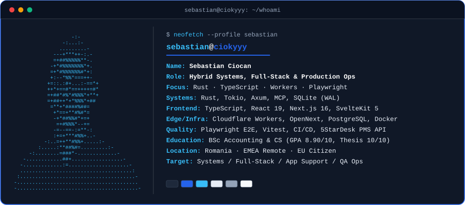

  

# Sebastian Ciocan

**Systems, Full-Stack & Production Ops** — Rust · TypeScript · Cloudflare Workers · Playwright · Romania (EU Citizen · EMEA Remote)

[ciocan.sebastian45@gmail.com](mailto:ciocan.sebastian45@gmail.com) · [LinkedIn](https://www.linkedin.com/in/sebastian-ciocan-a5aa5138b/) · [Perla Brazilor](https://perlabrazilor.com)

## About

I build and operate reliable software across systems tooling, full-stack TypeScript web apps, and edge production infrastructure. My work spans Rust agent proxies and MCP servers (`tokio`, `axum`, SQLite WAL), collaborative web platforms (`React 19`, `Next.js 16`, `SvelteKit 5`, `Convex`, `Yjs`), and Cloudflare Workers deployments backed by Playwright E2E regression suites.

Hold a BSc in Accounting & Computer Science (`GPA 8.90/10`, `Thesis 10/10`), combining systems engineering with hands-on financial operations, PMS/ERP integration, and live customer support at SC GORIOAN PROD COM SRL since Mar 2024. Previously directed a 15-person university engineering team across PR reviews, Agile sprints, and CI/CD delivery.

## Selected Projects

- **[emberloop-rs](https://github.com/ciokyyy/emberloop-rs)** — Local Rust proxy owning the model wire (`context compression`, `steering`, `tool policy`) for coding-agent harnesses, built with `tokio`, `axum`, an MCP tool server, SQLite WAL state, and a SvelteKit UI.
- **[licenta (Stratum Live)](https://github.com/ciokyyy/licenta)** — Real-time collaborative prompt-engineering platform featuring Yjs CRDT co-editing, version branching, RBAC permissions, Monaco Editor, encrypted BYOK keys, and Playwright E2E tests (`Next.js 16` + `React 19` + `Convex`). BSc thesis graded `10/10`.
- **[actual-perla (Perla Brazilor)](https://github.com/ciokyyy/actual-perla)** — Production multi-language hospitality platform ([perlabrazilor.com](https://perlabrazilor.com)) migrated from VPS to Cloudflare Workers via OpenNext, delivering live room availability through the `5StarDesk` PMS REST API, `RO/IT/EN` localization (`next-intl`), TanStack Query/Form workflows, and international SEO.
- **[skill-exchange](https://github.com/ciokyyy/skill-exchange)** — University skill-matching platform led with a 15-developer team: swipe matching, AI-assisted recommendations, authentication (`Better Auth`), and real-time chat on `Convex`.
- **[deictic](https://github.com/ciokyyy/deictic)** — Open-source Vite dev tool plugin (`herdr-plugin`): alt-click any rendered element in a running app to pass its source location, selector path, and computed browser styles to a coding agent; zero runtime dependencies, `61` tests.

## Experience

**Sales Manager & Web Developer (Part-Time)** · **SC GORIOAN PROD COM SRL** · *Mar 2024 – Present*

- Manage daily accounting, invoicing, receivables, fiscal compliance, and multi-channel guest support across `RO/IT/EN`.
- Built, migrated, and operate the company production portal on Cloudflare Workers, integrating `5StarDesk` PMS API room availability with zero-downtime edge caching.

## Core Stack & Credentials

- **Systems & Agent Infra:** Rust, Tokio, Axum, Model Context Protocol (MCP), SQLite (WAL), CLI/proxy tooling
- **Web & Realtime:** TypeScript, React 19, Next.js 16 (App Router), SvelteKit 5, SolidJS, Convex, Yjs CRDT, Better Auth, Tailwind CSS
- **Edge, Infra & Quality:** Cloudflare Workers, OpenNext, PostgreSQL, Drizzle ORM, Docker, Coolify, Vite, Playwright E2E, Vitest
- **Education & Languages:** BSc in Accounting & Computer Science (`GPA 8.90/10`, `Thesis 10/10`) · Cambridge English `C1` · Romanian (Native) · Italian (Conversational)
